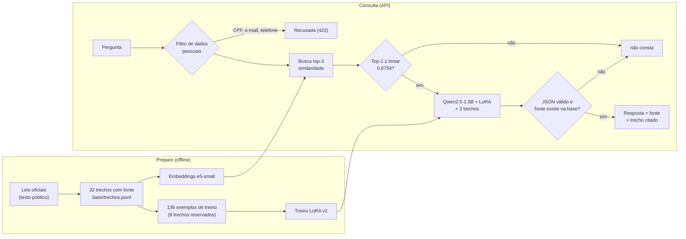

# Relatório · Guiding Hand: assistente de direitos e mobilidade

Disciplina Generative AI for Engineering (FIAP). Tema: **Mobilidade**. Repositório: ver seção 7.

## 1. Integrantes

| Nome completo | RM |
|---|---|
| João Rodrigo Solano Nogueira | 551319 |
| Julia Amorim Bezerra | 99609 |
| Lana Giulia Auada Leite | 551143 |
| Tony Willian da Silva Segalin | 550667 |

## 2. Ficha técnica

**Problema.** Pessoas com deficiência visual (e quem as acompanha) têm dúvidas sobre direitos de acessibilidade e transporte (táxi, transporte coletivo, estacionamento, locadoras, calçadas) e as leis são longas e difíceis de consultar. Um modelo de linguagem sem contexto responde com confiança, mas inventa leis (ver seção 5).

**O que a IA resolve.** Um assistente que responde perguntas sobre esses direitos **somente com base em trechos de lei**, devolve **JSON**, **cita a fonte** (lei e artigo) e **recusa** ("não consta na base de conhecimento") quando a base não responde. Faz parte do projeto Guiding Hand (óculos inteligentes para pessoas com deficiência visual, Global Solution): o assistente seria a camada de consulta de direitos.

**O que ela não faz.** Não dá parecer jurídico, não conhece leis municipais nem horários ou tarifas, e não cobre a LGPD (a base cobre a Lei Brasileira de Inclusão e as leis que ela alterou).

| Item | Escolha |
|---|---|
| Modelo de linguagem | Qwen2.5-1.5B-Instruct (local, fp16) |
| Embeddings | intfloat/multilingual-e5-small (CPU) |
| Especialização | LoRA (QLoRA 4-bit, r=8, alfa=16, 3 épocas, 136 exemplos), treinado em 624 s com pico de 1,6 GB de VRAM |
| Hardware | NVIDIA RTX 3050 Ti Laptop, 4 GB |
| Configurações comparadas | **A** modelo sem contexto · **B** RAG simples + limiar · **C** RAG + LoRA v2 + limiar |

## 3. Pipeline

## 4. Base de conhecimento

32 trechos de lei, cada um com id, fonte (lei e artigo), tema, link e licença. As leis são textos oficiais de domínio público. O texto veio do portal normas.leg.br e deve ser conferido no Planalto antes de usar a base em produção.

[PREENCHER: colar aqui a tabela de `base/FONTES.md` (fonte, formato, licença, número de trechos)]

## 5. Performance

### Busca (notebook 02)

Medida nos 27 casos com resposta: **recall@1 = 81,5% (22/27)** e **recall@3 = 96,3% (26/27)**. Nos 5 casos em que o recall@1 falha, o trecho certo ficou em 2º ou 3º lugar em 4 deles; no quinto (Q02) ficou fora do top-3, que é o único erro de recall@3. A causa é a sobreposição de conteúdo entre artigos (por exemplo, acessibilidade no art. 3º e no art. 53).

**Limiar de similaridade: 0,8754.** Escolhido pela melhor média entre aceitar as perguntas respondíveis e recusar as sem resposta: aceita 96,3% das respondíveis e recusa 100% das 8 sem resposta. A margem é estreita (a maior similaridade entre as sem resposta é 0,873), e o limiar foi calibrado nos mesmos 35 casos em que é medido, então o resultado tende a ser otimista.

### Placar das três configurações (35 casos: 27 com resposta, 8 "não consta")

| Métrica | A: sem contexto | B: RAG + limiar | C: RAG + LoRA v2 + limiar |
|---|---|---|---|
| Acerto (/27) | 7 | 19 | **25** (23 sem a correção da métrica) |
| Citação correta (/27) | 0 | 21 | **22** |
| Recusa correta (/8) | 2 | 8 | 8 |
| Recusa indevida (/27) | 0 | 1 | 1 |
| JSON válido (/35) | 33 | 34 | **35** |
| Alucinação (/35) | 31 (89%) | 0 (0%) | 0 (0%) |

Placar completo, com e sem limiar, e com o LoRA v1 (`avaliacao/placar_sem_correcao.csv` e `avaliacao/placar_com_correcao.csv`):

| Métrica | A | B | B sem limiar | C v1 | C v1 sem limiar | C | C sem limiar |
|---|---|---|---|---|---|---|---|
| Acerto, sem correção | 7 | 19 | 20 | 20 | 21 | 23 | 24 |
| Acerto, com correção | 7 | 19 | 20 | 20 | 21 | 25 | 26 |
| Citação correta | 0 | 21 | 22 | 21 | 22 | 22 | 23 |
| Recusa correta | 2 | 8 | 5 | 8 | 7 | 8 | 7 |
| Alucinação | 31 | 0 | 3 | 0 | 1 | 0 | 1 |

**Sobre a correção da métrica.** O acerto exige que as palavras-chave do gabarito apareçam na resposta. A lei escreve "1 (um) a 3 (três) anos" e "20 (vinte)", e a resposta do modelo trazia "1 a 3 anos" e "20", então a métrica marcava como erro duas respostas corretas do C (Q16 e Q19). A correção (números por extenso contam como dígitos) foi aplicada a todas as configurações e só alterou o C, mas foi descoberta depois de ver os resultados dele, por isso os dois placares aparecem lado a lado. Uma terceira resposta correta, a do B no Q10 ("não pode cobrar ingresso mais caro" contra o gabarito "não poderá ser superior"), também é marcada como erro pela métrica por palavras-chave e não foi corrigida. Contando-a à mão, o B tem 20 acertos e o C ganha por 5 casos (25 contra 20).

### Trechos vistos e não vistos no treino do LoRA

8 trechos foram deixados de fora do treino (T03, T09, T10, T12, T16, T20, T28, T31) para medir se o modelo generaliza ou só decorou. Com a métrica corrigida, nos casos com resposta:

| Configuração | Acerto, não visto (/8) | Acerto, visto (/19) | Citação, não visto (/8) | Citação, visto (/19) |
|---|---|---|---|---|
| A: sem contexto | 2 | 5 | 0 | 0 |
| B: RAG + limiar | 5 | 14 | 7 | 14 |
| C v1: RAG + LoRA v1 + limiar | 7 | 13 | 6 | 15 |
| C: RAG + LoRA v2 + limiar | 8 | 17 | 8 | 14 |

O grupo "não visto" tem só 8 casos, então a leitura é um indício, não uma prova: o modelo ajustado não piorou em trechos que nunca viu.

### Demonstração de alucinação (config A)

- Pergunta: *"Quanto da frota de táxi deve ser acessível?"* O modelo sem contexto respondeu "ao menos 50% das solicitações" e citou a **Lei Maria da Penha**. A base diz 10% da frota (Lei 13.146/2015, art. 51), e o B respondeu isso.
- Pergunta: *"Qual o valor em reais da multa por estacionar em vaga reservada?"* A respondeu "entre R$100 e R$500" e citou a Lei 8.078/90 como "Código de Trânsito Brasileiro" (é o Código de Defesa do Consumidor). O B recusou, porque a base não traz valores de multa.
- Perguntas sobre a Lei Brasileira de Inclusão: A citou a Lei 12.965/2014 (Marco Civil da Internet) como se fosse a LBI.
- No total, A alucinou em 31 dos 35 casos (89%); o B e o C, com limiar, em nenhum.

### Custo

Treino do LoRA: 624 s, 1,6 GB de VRAM. Inferência: cerca de 3,1 GB de VRAM e cerca de 5 s por pergunta (35 perguntas em 182 s).

## 6. Os 5 erros

São os 5 erros restantes da configuração final (C), nos 35 casos. Os arquivos `avaliacao/resultados/C2.json` trazem as saídas completas. As correções são **propostas, não testadas**.

### Erro 1 · Q02: a busca não trouxe o trecho certo
- **Pergunta:** "O que significa acessibilidade segundo a Lei Brasileira de Inclusão?" Esperado: art. 3º, I. Buscou: T17, T11, T21 (o certo ficou de fora do top-3).
- **Saída:** definiu acessibilidade corretamente pelo art. 53 e citou "art. 53", que não é o artigo do gabarito.
- **Causa provável:** dois artigos definem acessibilidade e o art. 53 é curto e casa melhor com a pergunta. As similaridades do modelo e5 ficam numa faixa estreita (0,85 a 0,93), então pequenas diferenças decidem o ranking.
- **Correção proposta:** busca híbrida (palavras-chave mais embeddings) ou reranqueamento; e aceitar mais de um trecho correto no gabarito quando dois artigos respondem à pergunta.

### Erro 2 · Q04: o limiar recusou uma pergunta que a base respondia
- **Pergunta:** "O que são barreiras urbanísticas?" O trecho certo (T04) ficou em 1º, mas com similaridade 0,848, abaixo do limiar 0,8754.
- **Saída:** "Não consta na base de conhecimento" (recusa indevida). Sem o limiar, B e C respondem certo.
- **Causa:** um limiar único para toda a base; perguntas curtas contra trechos longos têm similaridade menor mesmo quando o trecho está certo. Além disso, o limiar foi calibrado nos mesmos casos do teste.
- **Correção proposta:** decidir a recusa com mais de um sinal (limiar mais a diferença entre o 1º e o 2º trecho), calibrar o limiar em casos separados dos de teste, ou deixar o modelo decidir quando a similaridade cair numa zona cinza.

### Erro 3 · Q05: resposta mistura dois trechos e cita o artigo errado
- **Pergunta:** "Recusar uma adaptação razoável conta como discriminação?" Esperado: art. 4º (T05, que ficou em 1º, com 0,884).
- **Saída:** "Sim. Praticar, induzir ou incitar discriminação em razão da deficiência implica recusar adaptações razoáveis", citando o art. 88, que é o artigo da pena do crime de discriminação.
- **Causa:** os três trechos buscados falam de discriminação e o modelo de 1,5 bilhão de parâmetros misturou o texto do art. 88 com a ideia do art. 4º.
- **Correção proposta:** mostrar ao modelo só o melhor trecho quando a diferença de similaridade for grande, e usar reranqueamento.

### Erro 4 · Q07: resposta correta com o artigo citado errado
- **Pergunta:** "A pessoa com deficiência tem direito a pontos de parada e terminais acessíveis no transporte coletivo?" Esperado: art. 9º (T07, em 1º com 0,923).
- **Saída:** "Sim..." (certo), mas citou "art. 48, caput, § 1º e § 2º".
- **Causa:** o campo "fonte" é texto livre gerado pelo modelo, que o copiou de outro trecho do prompt.
- **Correção proposta:** o modelo devolver o **id do trecho usado** (por exemplo "T07") e o código preencher a fonte a partir da base, de modo que a fonte nunca seja inventada ou deformada.

### Erro 5 · Q15: resposta correta com o artigo citado errado
- **Pergunta:** "O táxi pode cobrar tarifa diferente de pessoa com deficiência?" Esperado: art. 51 (T15, em 1º com 0,925).
- **Saída:** "Não. É proibida a cobrança diferenciada..." (certo), mas citou "art. 46, caput".
- **Causa e correção:** as mesmas do erro 4. Os erros 3, 4 e 5 mostram o mesmo padrão: o trecho certo está em 1º, mas o modelo erra qual artigo citar. **Atenção:** citar sempre o trecho top-1 *não* é uma boa correção, porque nos casos em que o recall@1 falha o modelo hoje às vezes cita o certo (por exemplo, Q19, cujo top-1 era outro trecho). A correção proposta pelo id do trecho precisa ser testada.

### Erros que já foram corrigidos durante o projeto
- **Treino do LoRA v1 (Q12):** a resposta-alvo era um resumo que copiava o início do trecho e perdia o dado pedido ("2%"). O LoRA aprendeu a copiar o começo em vez de responder, e ficou praticamente empatado com o RAG simples. O v2 usa respostas diretas e curtas, escritas à mão e conferidas contra o trecho, e o Q12 passou a responder "2% do total, garantida no mínimo 1 vaga".
- **Métrica de acerto:** não reconhecia números por extenso (seção 5).

## 7. Conclusão técnica

- **Contexto elimina quase toda a alucinação.** O mesmo modelo passou de 89% de alucinação (A) para 0% (B e C, com limiar), e de 0 para 21 ou 22 citações corretas em 27.
- **O limiar é o que sustenta a recusa, mas é frágil.** Com ele, a recusa é 8/8; sem ele, o B recusa 5 de 8 e responde 3 perguntas que a base não cobre. Em contrapartida, custou 1 pergunta respondível (Q04). A margem é estreita e a calibração foi feita nos mesmos casos do teste.
- **O LoRA v2 melhorou acerto e formato em relação ao RAG simples:** 25 contra 19 de acerto (25 contra 20 se contarmos à mão o Q10 do B) e JSON 100% válido, mas a diferença em citação (22 contra 21) e em recusa com limiar (8 contra 8) é nula ou de um caso. Sem o limiar, o modelo ajustado recusa mais (7 de 8 contra 5 do B), o que indica que aprendeu a recusar sozinho.
- **Limites.** Um único treino e 35 casos de teste: as diferenças pequenas não são conclusivas. A base cobre só a LBI e as leis que ela alterou; legislação municipal, valores e horários não constam. O texto das leis precisa ser conferido no Planalto.

### LGPD

A base é só texto de lei, sem dado pessoal. A API foi desenhada para minimizar dados: a pergunta não é gravada (o log guarda só status, similaridade e tempo), perguntas com CPF, e-mail ou telefone são recusadas, e o modelo roda local, sem enviar nada a serviços externos. A resposta traz a fonte e o trecho citado (explicabilidade) e um aviso de que não substitui orientação profissional. Isto descreve medidas técnicas de privacidade por desenho; não é parecer jurídico.

### Links

- Repositório: https://github.com/LanaAuada/guiding-hand-genai
- Vídeo: [PREENCHER: link do vídeo]
